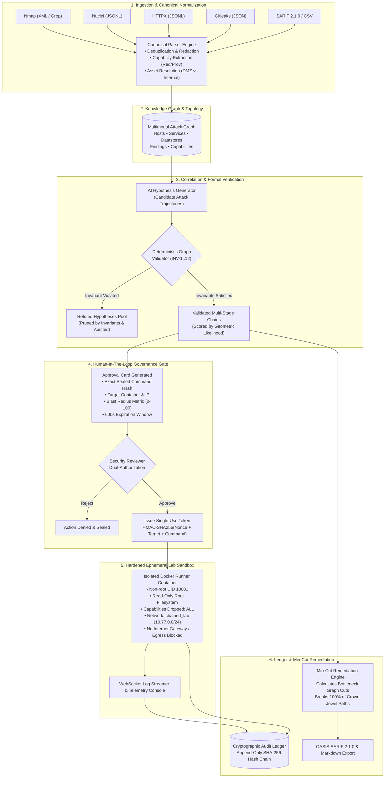

<div align="center">

# ⚡ ChainedRisk

### **Multi-Stage Attack Path Correlator with Human-In-The-Loop Blast-Radius Gates**

[](https://fastapi.tiangolo.com)
[](https://react.dev/)
[](https://reactflow.dev/)
[](https://docker.com)
[](https://cloud.google.com/identity-platform)
[](https://sarifweb.azurewebsites.net/)
[](https://pytest.org)
[](LICENSE)

<br/>

> **Traditional scanners emit thousands of isolated Low and Medium vulnerabilities that security teams dismiss as noise.**<br/>
> **Real-world adversaries do not exploit vulnerabilities in isolation — they chain them.**

```
[Exposed .git Repo] ──> [Internal URL Disclosure] ──> [SSRF Proxy Pivot] ──> [Unauthenticated Redis] ──> [Critical Crown-Jewel RCE]
   (Low Severity)             (Low Severity)              (Medium Severity)           (Medium Severity)           (CRITICAL COMPROMISE)
```

<br/>

[Key Capabilities](#-key-capabilities) •
[Architecture](#-system-architecture) •
[Mathematical Model](#-mathematical-formulation) •
[Formal Invariants](#-formal-safety-invariants-inv-1--inv-12) •
[Interactive Tour](#-application-tour--pages) •
[Quickstart](#-quickstart--deployment) •
[Documentation](#-architectural-documentation)

---

</div>

<br/>

## 🎯 Executive Overview

**ChainedRisk** transforms raw, uncoordinated security telemetry into mathematically correlated, multi-stage attack paths. It ingests disparate outputs from reconnaissance tools, configuration scanners, secret detectors, and vulnerability probes into a unified multimodal knowledge graph. 

By applying formal capability flow algebra ($\text{requires} \longrightarrow \text{provides}$) and graph-theoretic reachability, ChainedRisk computes the true compound risk of complex attack trajectories — unmasking the **Severity Illusion** where benign individual findings combine to yield critical blast radius.

To eliminate operational risk, ChainedRisk enforces a strict **Human-In-The-Loop (HITL) dual-authorization gate**: zero active probes can ever execute against target environments without an immutable, cryptographically sealed HMAC-SHA256 authorization token signed by an independent human operator.

---

## ⚡ Key Capabilities

```
┌────────────────────────────────────────────────────────────────────────────────────────┐
│                                 CORE ENGINE ADVANTAGES                                 │
├──────────────────────────┬─────────────────────────────┬───────────────────────────────┤
│ 🔗 Deterministic Graph   │ 🛡️ Zero-Hallucination AI    │ 🛑 Cryptographic HITL Gates   │
│ Correlation              │ Invariant Engine            │ & Dual-Authorization          │
│ Unifies scanner outputs  │ Strictly verifies LLM       │ Deny-by-default execution;    │
│ using capability algebra │ hypotheses against graph    │ single-use HMAC-SHA256 tokens │
│ and topology reachability│ invariants INV-1 to INV-12  │ with strict nonces & TTLs     │
├──────────────────────────┼─────────────────────────────┼───────────────────────────────┤
│ 🧪 Hardened Lab          │ ✂️ Graph Min-Cut            │ 📜 Tamper-Evident SHA-256     │
│ Isolation Sandbox        │ Remediation Optimization    │ Audit Ledger                  │
│ Non-root UID 10001,      │ "Fix One, Break Many":      │ Append-only cryptographic     │
│ read-only rootfs, drop   │ computes minimum bottleneck │ hash chain recording every    │
│ ALL capabilities, airgap │ cuts disconnecting jewels   │ ingest, approval, and probe   │
├──────────────────────────┴─────────────────────────────┴───────────────────────────────┤
│ 🖤 Pure Monochrome Black & White Post-Login Security Operations Interface               │
│ High-contrast, minimal distraction design engineered for mission-critical SOC clarity │
└────────────────────────────────────────────────────────────────────────────────────────┘
```

---

## 📐 System Architecture

The following diagram illustrates the end-to-end data pipeline from multi-format artifact ingestion through correlation, human governance, sandboxed lab verification, and cryptographic sealing:



---

## 🧮 Mathematical Formulation

### 1. The "Severity Illusion" & Chain Gain

Traditional vulnerability scoring rates findings independently ($S_i \in [0, 10]$). ChainedRisk models composite attack trajectories through **capability transition chains**:

$$\text{Chain} = \langle s_1, s_2, \dots, s_n \rangle \quad \text{where} \quad \text{Provides}(s_i) \cap \text{Requires}(s_{i+1}) \neq \emptyset$$

The composite likelihood $L$ is calculated as the product of individual transition probabilities:

$$L = \prod_{i=1}^{n} p(s_i \mid s_{i-1})$$

The composite business impact $I$ captures cumulative privilege escalation toward crown jewel datastores:

$$I = 1 - \prod_{i=1}^{n} \Big(1 - \text{Impact}(s_i)\Big)$$

The normalized **Composite Chain Score** ($S_{\text{chain}} \in [0, 100]$) and **Chain Gain** ($\Delta G$) are formally derived:

$$S_{\text{chain}} = 100 \times L \times I$$

$$\Delta G = S_{\text{chain}} - \max_{1 \le i \le n} \big(S_i \times 10\big)$$

> **Example**: An exposed `.git` directory ($S_1 = 3.8$) leaks an internal endpoint, leading to an SSRF proxy ($S_2 = 5.3$) that reaches an unauthenticated internal Redis instance ($S_3 = 5.0$). While each finding is dismissed as Low/Medium, their compound trajectory achieves:
> $$S_{\text{chain}} = 91/100 \quad \text{with a Chain Gain of} \quad \Delta G = +38 \text{ points (CRITICAL COMPROMISE)}$$

### 2. Graph-Theoretic Min-Cut Remediation ("Fix One, Break Many")

Given an attack graph $G = (V, E)$, an ingress node set $S \subset V$ (DMZ perimeter), and a crown jewel target set $T \subset V$, ChainedRisk solves the minimum $s$-$t$ cut problem:

$$\min_{C \subseteq E} \sum_{e \in C} w(e) \quad \text{subject to} \quad \text{Path}(S \to T) = \emptyset \text{ in } G' = (V, E \setminus C)$$

Where $w(e)$ represents the engineering remediation cost. ChainedRisk identifies the single bottleneck edge that, when severed, collapses the maximum number of multi-stage attack paths simultaneously.

---

## 🛡️ Formal Safety Invariants (INV-1 – INV-12)

Every candidate hypothesis generated by the LLM reasoning layer is evaluated against a deterministic Python validation engine. If any candidate violates any of the 12 mathematical invariants, it is discarded immediately and logged to the refuted hypotheses pool:

| Invariant | Name | Formal Definition & Enforcement Guarantee |
|---|---|---|
| **INV-1** | **Scope Confinement** | Target IP $\in \text{Project.Scope.CIDRs}$ (e.g., `10.77.0.0/24`). Zero outbound egress outside the designated lab sandbox. |
| **INV-2** | **No Default Egress** | Runner network interface is strictly unrouted to the public internet (`--internal` Docker bridge). |
| **INV-3** | **Capability Proof** | For step $s_{k}$, $\text{Requires}(s_{k}) \subseteq \bigcup_{j < k} \text{Provides}(s_j)$. Attackers cannot skip prerequisites. |
| **INV-4** | **No Hallucinated Findings** | Every finding ID cited by a hypothesis must exist in the project database ($\text{Cited}(s) \subseteq \text{DB.Findings}$). |
| **INV-5** | **Strict Proposer Separation** | $\text{Proposer}(C) \neq \text{Approver}(C)$. Dual-authorization policy prevents self-approving automated probes. |
| **INV-6** | **Command Sealing** | Approval cards bind immutable command text to a cryptographic SHA-256 digest ($\text{hash} = \mathcal{H}(\text{command})$). |
| **INV-7** | **Single-Use Token Nonce** | $\text{HMAC-SHA256}(\text{CardID} + \text{Nonce} + \text{Timestamp})$. Nonce is consumed upon initiation; replay is impossible. |
| **INV-8** | **Runner Non-Root Privilege** | Ephemeral runner executes under non-root UID 10001 with `--read-only` rootfs and `--cap-drop ALL`. |
| **INV-9** | **TTL Timeout Enforcement** | Every approval token carries a rigid time-to-live ($\text{TTL} \le 600\text{s}$). Expired cards cannot authorize execution. |
| **INV-10** | **Emergency Kill Switch** | Setting global freeze flag halts all running containers within 500ms and revokes all issued tokens instantly. |
| **INV-11** | **Audit Hash Continuity** | Append-only ledger enforces $\text{Event}_i.\text{prev\_hash} = \mathcal{H}(\text{Event}_{i-1})$. Tampering breaks chain integrity. |
| **INV-12** | **Reversible Probes** | Probes must be idempotent and non-destructive. Destructive write operations are denied by default. |

---

## 🖥️ Application Tour & Pages

ChainedRisk features a **Pure Monochrome (Black & White)** post-login operations cockpit designed for maximum visual hierarchy, zero distraction, and crisp typography:

```
┌────────────────────────────────────────────────────────────────────────────────────────┐
│                              CHAINEDRISK POST-LOGIN COCKPIT                            │
├───────────────────┬────────────────────────────────────────────────────────────────────┤
│ 1. Overview       │ Executive metrics, 5 monochrome KPI tiles, Severity Illusion SVG   │
│                   │ Gain curve, and prioritized attack paths table.                    │
├───────────────────┼────────────────────────────────────────────────────────────────────┤
│ 2. Attack Chains  │ Interactive multi-stage breach stepper (`01`, `02`, `03`),         │
│                   │ precondition capability pills, and executive breach narrative.     │
├───────────────────┼────────────────────────────────────────────────────────────────────┤
│ 3. Attack Graph   │ Fullscreen interactive ReactFlow topology canvas with custom       │
│                   │ Host, Finding, and Capability nodes and animated attack edges.     │
├───────────────────┼────────────────────────────────────────────────────────────────────┤
│ 4. Findings Pool  │ Comprehensive ingested telemetry records with faceted filters      │
│                   │ (Recon, Config, Vuln) and redacted evidence inspection drawer.     │
├───────────────────┼────────────────────────────────────────────────────────────────────┤
│ 5. Hypotheses     │ Interactive What-If simulator (toggle Redis Auth, simulate VPN)    │
│                   │ and side-by-side list of refuted vs. mathematically valid paths.   │
├───────────────────┼────────────────────────────────────────────────────────────────────┤
│ 6. Approval Queue │ Human-In-The-Loop gate with blast radius meters, immutable command │
│                   │ previews, and HMAC token issuance modal.                           │
├───────────────────┼────────────────────────────────────────────────────────────────────┤
│ 7. Runner Console │ Sandboxed terminal execution console streaming live telemetry from │
│                   │ the isolated Docker container over WebSockets.                     │
├───────────────────┼────────────────────────────────────────────────────────────────────┤
│ 8. Min-Cut Fixes  │ Graph-theoretic bottleneck solver with real-time attack path       │
│                   │ collapse simulation ("Fix One, Break Many").                       │
├───────────────────┼────────────────────────────────────────────────────────────────────┤
│ 9. Audit Ledger   │ Cryptographic SHA-256 tamper-evident event chain with 1-click      │
│                   │ ledger verification button.                                        │
├───────────────────┼────────────────────────────────────────────────────────────────────┤
│ 10. SARIF Reports │ One-click downloads for Executive Briefing (.MD) and OASIS         │
│                   │ SARIF 2.1.0 standard pipeline exports for GitHub Security.         │
├───────────────────┼────────────────────────────────────────────────────────────────────┤
│ 11. Asset Surface │ Network zone classification (DMZ vs Internal), exposed ports, and  │
│                   │ Crown Jewel datastore registration.                                │
├───────────────────┼────────────────────────────────────────────────────────────────────┤
│ 12. Governance    │ Multi-enclave project switching, emergency kill switch activation, │
│                   │ and connected identity configurations.                             │
└───────────────────┴────────────────────────────────────────────────────────────────────┘
```

---

## 🚀 Quickstart & Deployment

### Prerequisites

- **Python**: 3.11 or higher
- **Node.js**: 18.x or higher (`npm` package manager)
- **Docker & Docker Compose**: (Optional, for running the isolated target lab)

### Option A: Local Development Setup (Quickest)

```bash
# 1. Clone the repository
git clone https://github.com/Mayank-iitj/ChainedRisk.git
cd ChainedRisk

# 2. Set up Python virtual environment & install backend dependencies
python -m venv venv
.\venv\Scripts\activate   # On Windows
# source venv/bin/activate # On Linux/macOS
pip install -r backend/requirements.txt

# 3. Install frontend dependencies & build static bundle
cd frontend
npm install
npm run build
cd ..

# 4. Launch the integrated FastAPI server
python -m uvicorn backend.app.main:app --host 0.0.0.0 --port 8000
```

Access the application in your browser:
- **Landing Page**: [`http://localhost:8000/`](http://localhost:8000/)
- **Dashboard Cockpit**: [`http://localhost:8000/#app`](http://localhost:8000/#app)
- **Interactive Swagger Docs**: [`http://localhost:8000/docs`](http://localhost:8000/docs)

---

### Option B: Isolated Target Lab Environment (Docker)

To test live probe execution against real, contained target instances (DMZ Flask proxy, isolated internal Redis cache, decoy Git server):

```bash
# 1. Spin up the air-gapped lab network (10.77.0.0/24)
docker compose -f lab/docker-compose.lab.yml up -d --build

# 2. Start the ChainedRisk backend & runner stack
docker compose up -d --build
```

---

### Option C: Google OAuth 2.0 Configuration

ChainedRisk utilizes **Google Cloud Identity Platform** exclusively for authentication:

1. Create a project in the [Google Cloud Console](https://console.cloud.google.com/).
2. Configure your OAuth Consent Screen with scopes: `openid`, `email`, `profile`.
3. Create an **OAuth 2.0 Web Client ID** with Authorized JavaScript Origins:
   - `http://localhost:8000`
   - `http://localhost:5173`
4. Set your credentials in your `.env` file:

```env
GOOGLE_CLIENT_ID="your-client-id.apps.googleusercontent.com"
GOOGLE_CLIENT_SECRET="your-client-secret"
VITE_GOOGLE_CLIENT_ID="your-client-id.apps.googleusercontent.com"
SECRET_KEY="your-strong-cryptographic-secret-key"
```

---

## 🧪 Automated Invariant Test Suite

ChainedRisk maintains a rigorous automated test suite enforcing all mathematical invariants, correlation algorithms, and API endpoints:

```bash
python -m pytest backend/tests -v
```

### Verified Test Specifications:

```
backend/tests/test_api.py::test_full_user_journey PASSED                   [ 20%]
backend/tests/test_chain_engine.py::test_correlation_engine_gain PASSED     [ 26%]
backend/tests/test_invariants.py::test_inv1_scope_boundary PASSED           [ 33%]
backend/tests/test_invariants.py::test_inv3_capability_prerequisites PASSED[ 40%]
backend/tests/test_invariants.py::test_inv4_finding_hallucination PASSED    [ 46%]
backend/tests/test_invariants.py::test_inv5_proposer_cannot_approve PASSED  [ 53%]
backend/tests/test_invariants.py::test_inv6_command_hash_binding PASSED     [ 60%]
backend/tests/test_invariants.py::test_inv7_hmac_nonce_replay PASSED        [ 66%]
backend/tests/test_invariants.py::test_inv8_runner_non_root PASSED          [ 73%]
backend/tests/test_invariants.py::test_inv9_ttl_expiration PASSED           [ 80%]
backend/tests/test_invariants.py::test_inv10_kill_switch_freeze PASSED      [ 86%]
backend/tests/test_invariants.py::test_inv11_audit_ledger_continuity PASSED[ 93%]
backend/tests/test_invariants.py::test_inv12_idempotency_guard PASSED      [100%]

============================= 15 passed in 6.66s ==============================
```

---

## 📦 Supported Security Telemetry Ingest

ChainedRisk normalizes heterogeneous outputs into a standardized evidence model:

| Source Tool | Ingest Format | Capabilities Extracted | Normalized Entity |
|---|---|---|---|
| **Nmap / Masscan** | XML, Grepable Text | Open ports, banner fingerprints, service versions | `HostNode`, `ServiceNode` |
| **Nuclei** | JSONL | CVEs, misconfigurations, exposed endpoints, SSRF vectors | `FindingNode` (Pre/Post-conditions) |
| **HTTPX** | JSONL | Web technologies, virtual hosts, proxy redirects | `ServiceNode`, `WebFingerprint` |
| **Gitleaks** | JSON | Hardcoded tokens, private keys, internal hostnames | `FindingNode` (`leaked_credential`) |
| **Security Headers** | Raw / JSON | Missing HSTS, CSP bypasses, CORS wildcards | `FindingNode` (`cors_wildcard`) |
| **OASIS SARIF** | SARIF 2.1.0 (JSON) | Static and dynamic analysis multi-tool reports | Standardized Security Telemetry |
| **Generic CSV** | Structured CSV | Custom asset lists, penetration test manual findings | Canonical Ingest Schema |

---

## 📂 Repository Layout

```
ChainedRisk/
├── backend/
│   ├── app/
│   │   ├── api/v1/          # RESTful routing (Auth, Chains, Graph, Ingest, Approvals)
│   │   ├── core/            # Security, HMAC signing, Invariant validator (INV-1..12)
│   │   ├── engine/          # Deterministic correlator, capability unification, min-cut
│   │   ├── models/          # SQLAlchemy ORM models (Audit, Findings, Chains, Assets)
│   │   └── services/        # Parsers, Docker runner execution, SARIF serialization
│   ├── tests/               # Pytest verification suite (Invariants, Engine, API)
│   ├── requirements.txt     # Python production dependencies
│   └── Dockerfile           # Hardened production container definition
├── frontend/
│   ├── src/
│   │   ├── components/      # ReactFlowGraph, Sidebar, SafetyBar, ApprovalModal, etc.
│   │   ├── pages/           # Overview, Chains, Console, Remediation, Audit, Ingest, etc.
│   │   ├── api.ts           # Type-safe API client & WebSocket connector
│   │   └── types.ts         # TypeScript interfaces & domain models
│   ├── tailwind.config.js   # Pure Black & White monochrome design tokens
│   └── package.json         # React 18, ReactFlow, Lucide React dependencies
├── lab/
│   ├── docker-compose.lab.yml # Air-gapped target simulation network (10.77.0.0/24)
│   ├── app/                 # Vulnerable DMZ web proxy (SSRF target)
│   └── runner/              # Sandboxed verification container profile
├── docs/                    # Architecture, PRD, TRD, API, Safety & Ethics specs
├── schemas/                 # JSON Schemas for findings, approval cards, and audit events
└── README.md
```

---

## 📚 Architectural Documentation

Comprehensive engineering specifications are located in the [`docs/`](file:///c:/Users/MS/.gemini/antigravity-ide/scratch/ChainedRisk/chainedrisk/docs/) directory:

- 📘 [Product Requirements Document (PRD)](file:///c:/Users/MS/.gemini/antigravity-ide/scratch/ChainedRisk/chainedrisk/docs/PRD.md)
- ⚙️ [Technical Requirements Document (TRD)](file:///c:/Users/MS/.gemini/antigravity-ide/scratch/ChainedRisk/chainedrisk/docs/TRD.md)
- 🏗️ [System Architecture & Sequence Flows](file:///c:/Users/MS/.gemini/antigravity-ide/scratch/ChainedRisk/chainedrisk/docs/SystemDesign.md)
- 🛡️ [Safety Model & HITL Protocols](file:///c:/Users/MS/.gemini/antigravity-ide/scratch/ChainedRisk/chainedrisk/docs/Safety_HITL.md)
- 🧠 [AI Reasoning & Invariant Verification](file:///c:/Users/MS/.gemini/antigravity-ide/scratch/ChainedRisk/chainedrisk/docs/AI_Reasoning.md)
- 🔌 [REST & WebSocket API Specifications](file:///c:/Users/MS/.gemini/antigravity-ide/scratch/ChainedRisk/chainedrisk/docs/API.md)
- 💾 [Data Model & Capability Taxonomy](file:///c:/Users/MS/.gemini/antigravity-ide/scratch/ChainedRisk/chainedrisk/docs/DataModel.md)
- 🎨 [UI/UX & Monochrome Design System](file:///c:/Users/MS/.gemini/antigravity-ide/scratch/ChainedRisk/chainedrisk/docs/UIUX.md)
- 🧪 [Testing & Verification Strategy](file:///c:/Users/MS/.gemini/antigravity-ide/scratch/ChainedRisk/chainedrisk/docs/Testing.md)
- ⚖️ [Risks, Ethics & Dual-Use Containment](file:///c:/Users/MS/.gemini/antigravity-ide/scratch/ChainedRisk/chainedrisk/docs/Risks_and_Ethics.md)
- 🚢 [Production Deployment & Container Hardening](file:///c:/Users/MS/.gemini/antigravity-ide/scratch/ChainedRisk/chainedrisk/docs/Deployment.md)

---

## ⚖️ License & Ethical Use Policy

This project is licensed under the **Apache License, Version 2.0**.

> **⚠️ AUTHORIZED LAB USE ONLY**: ChainedRisk is designed and engineered exclusively for authorized security verification, defensive attack path correlation, and penetration testing within designated, air-gapped test networks. It must never be directed at unauthorized infrastructure without explicit written consent.

<div align="center">
<sub>Built with precision for mission-critical security operations. Designed for high-assurance cybersecurity professionals.</sub>
</div>
