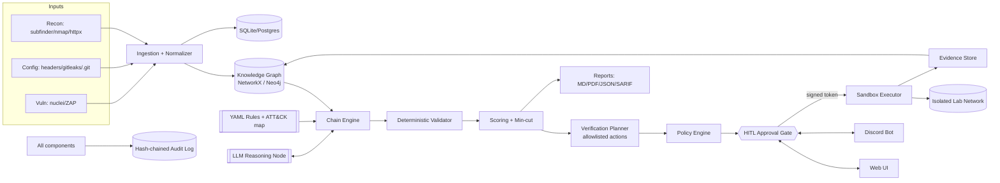
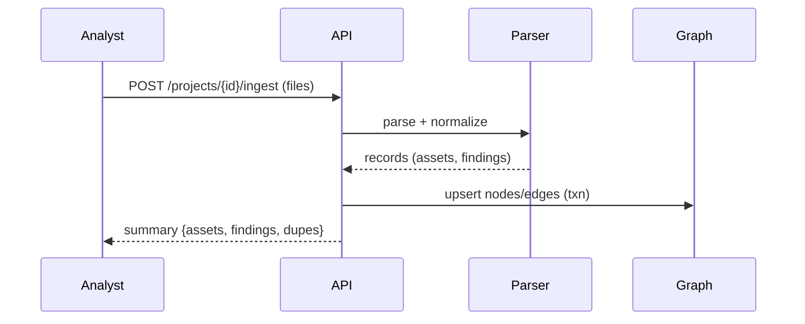
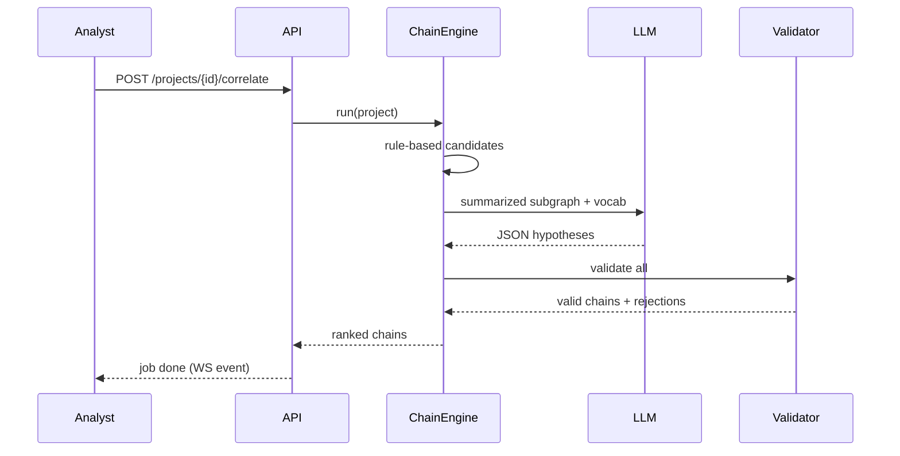

# System Design - ChainedRisk

## 1. Architecture Overview


## 2. Component Responsibilities
| Component | Responsibility | Trust level |
|---|---|---|
| API Gateway (FastAPI) | AuthN/Z, validation, orchestration, WebSocket | Trusted |
| Ingestion | Parse/normalize untrusted tool output | Untrusted input, sandboxed parsing |
| Graph Service | Store/query knowledge graph | Trusted |
| Chain Engine | Generate/validate/score chains | Trusted (LLM output untrusted until validated) |
| LLM Adapter | Prompting, JSON-mode, retries | External, untrusted output |
| Verification Planner | Map steps to allowlisted actions | Trusted |
| Policy Engine | Deny-by-default decisions | Trusted, small, heavily tested |
| Approval Service | Cards, tokens, state machine | Trusted |
| Discord Bot | Remote approval channel | Semi-trusted (identity-checked) |
| Executor | Runs steps in containers | Trusted controller; runner untrusted |
| Lab | Intentionally vulnerable targets | Untrusted, isolated |
| Audit | Tamper-evident log | Trusted |

## 3. Core Flows
### 3.1 Ingest -> Graph

### 3.2 Correlate

### 3.3 Verify with HITL gate
```mermaid
sequenceDiagram
  participant A as Agent (Planner)
  participant POL as Policy
  participant AP as Approval Svc
  participant H as Human (UI/Discord)
  participant EX as Executor
  participant LAB as Lab
  A->>POL: evaluate(step)
  POL-->>A: risk=L1, approval required
  A->>AP: create card (cmd, target, blast radius, reason)
  AP-->>H: Approval Card (WS + Discord)
  Note over A,EX: Agent PAUSED - nothing runs
  H->>AP: Approve (or Deny / Narrow)
  AP-->>A: signed single-use token
  A->>EX: run(step, token)
  EX->>EX: verify HMAC, hash, expiry, nonce, kill lock
  EX->>LAB: execute in hardened container
  LAB-->>EX: result
  EX-->>A: verdict + evidence
  A->>AP: consume token; audit
```
### 3.4 Kill switch
`POST /kill` -> set global lock -> docker stop all labelled runs -> mark pending cards CANCELLED -> audit.

## 4. Blast Radius Computation
For a step targeting asset T with action A:
- `reachable_assets` = nodes reachable from T in `CAN_REACH` within 2 hops (graph query).
- `data_at_risk` = DataStore nodes attached to reachable assets, with sensitivity labels.
- `state_change` from action metadata (none | reversible | irreversible).
- `network_scope` = {lab-only, lab+internal-sim}; anything else denies.
- `blast_score` = min(100, 20*|reachable_services| + 30*(sensitivity_max) + 25*(state_change_weight) + 10*(creds_in_scope)).
- Risk level mapping: blast_score<20 and no state change -> L1; 20-60 or reversible change -> L2; >60 or irreversible -> L3.
Shown on the card as a mini subgraph highlighting T and reachable assets.

## 5. Approval Card Content (canonical)
```
Title: Verify SSRF -> Redis pivot (Chain C-03, Step 2/3)
Command (exact):  ssrf_canary_probe --url http://app.lab:8080/fetch?u=http://redis.lab:6379/ --expect reachable
Target container: redis-lab (10.77.0.12) via app-lab (10.77.0.10)
Risk: L1 (read-only, reversible, lab-only)
Blast radius: 2 hosts, 1 datastore (cache, synthetic data), 0 credentials, state change: none
Why: Finding F-12 (SSRF) provides capability net_pivot_internal; F-17 (Redis no auth) requires internal reachability.
Rollback: none needed. Timeout: 20s. Expires: 10 min.
[Approve] [Deny] [Narrow scope] [View evidence]
```

## 6. Data Storage
- SQLite tables: projects, assets, findings, edges, chains, chain_steps, verification_plans, approval_cards, approvals, executions, evidence, audit_events, users.
- Evidence blobs on disk `/data/evidence/{sha256}`; metadata in DB; secrets redacted at render.
- Graph persisted as node/edge tables; NetworkX loaded per project into memory (LRU of 5 projects).

## 7. Deployment Topology
```
[ docker host ]
  net: chained_app (bridge)   -> frontend:5173, api:8000, neo4j:7687 (opt), bot
  net: chained_lab (internal) -> app-lab, redis-lab, git-lab, runner containers (spawned)
  api has docker.sock access via restricted proxy (tecnativa/docker-socket-proxy: containers/networks only)
```
Executor never gets host networking; lab network has `internal: true`.

## 8. Failure Modes & Mitigations
| Failure | Mitigation |
|---|---|
| LLM down/invalid JSON | Retry once; fallback to rules-only; UI banner |
| LLM hallucinated step | Validator drops; counted in metrics |
| Approval token replay | Nonce single-use; hash bound |
| Discord outage | Web approval remains; cards visible in UI |
| Runner escape attempt | Non-root, caps dropped, seccomp, no egress, docker-socket-proxy |
| Prompt injection via scanner output | Evidence is data not instructions; fields escaped, delimited, schema-constrained output; actions allowlisted |
| Large graphs | Subgraph summarization; candidate cap; time budget |
| DB corruption | WAL + nightly backup; audit verify |

## 9. Scalability Path
Neo4j adapter, Redis queue + workers, Postgres, multi-tenant `org_id` partitioning, Kubernetes executor with gVisor/Kata.
